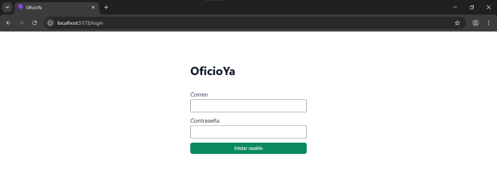
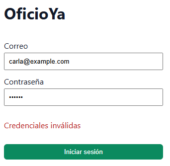
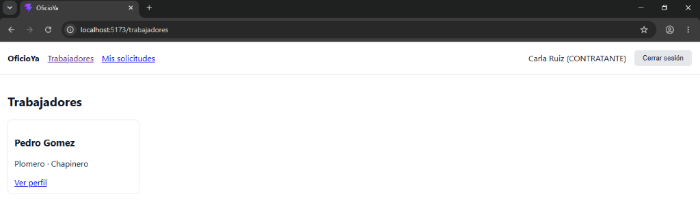
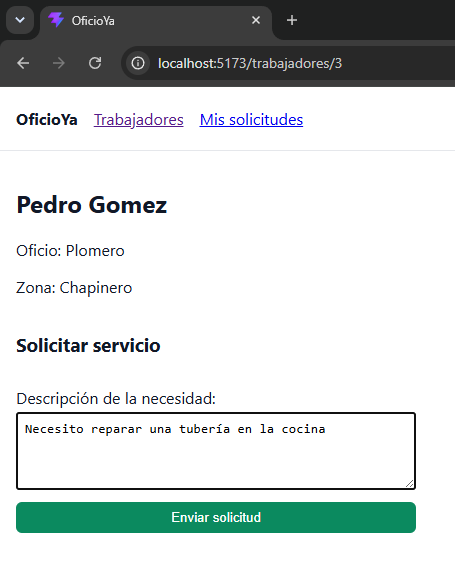
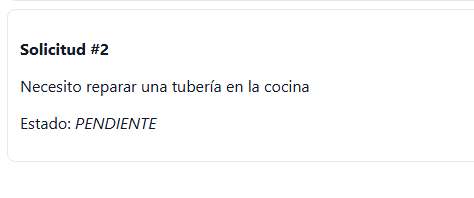
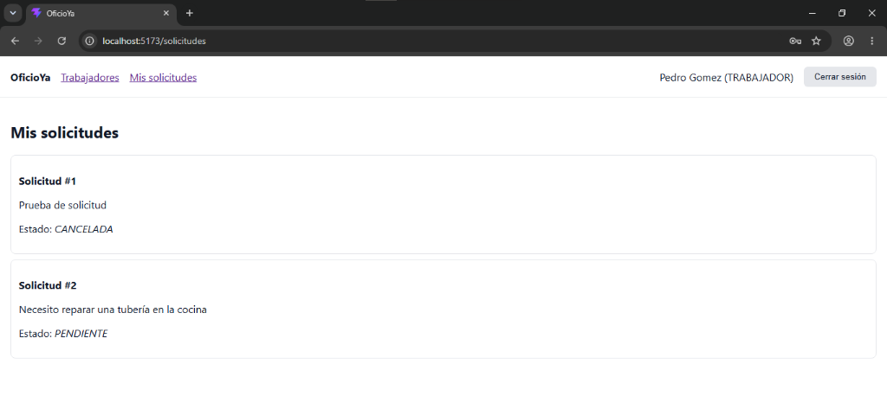
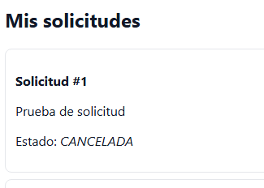
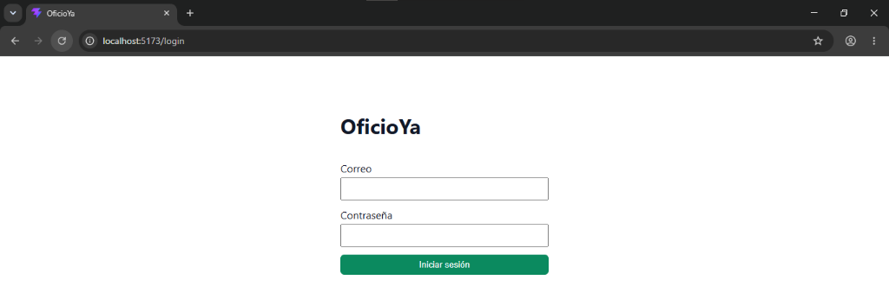
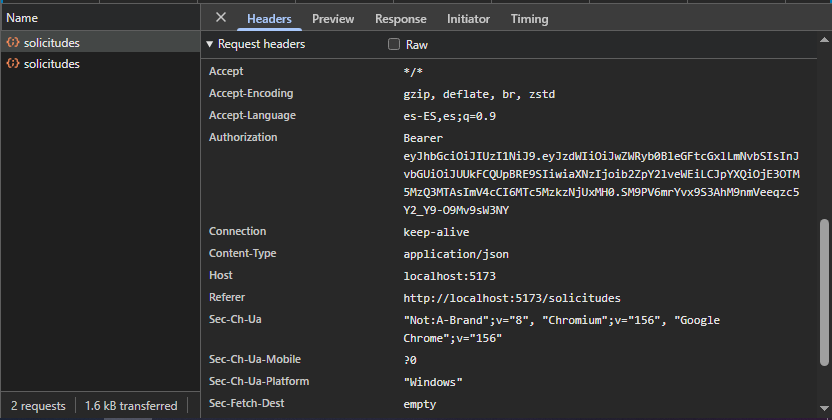

# OficioYa · Front-End (Laboratorio 9)
 
Aplicación React + Vite que consume la API del laboratorio de seguridad.
 
## Requisitos y Ejecución

### Prerrequisitos

1. **Node.js:** Versión 20.19+ o 22.12+.
2. **Backend en ejecución:** La API de Spring Boot debe estar corriendo en `http://localhost:8080`.
   - Repositorio del Backend: [https://github.com/Zixer/DOSW_Lab8_Buitrago_Ibanez_Murillo_Sanchez_Vega.git]

### Pasos para ejecutar la aplicación

1. Clonar el repositorio

Clonar el repositorio y ubicarse en la carpeta del proyecto:

```bash
git clone https://github.com/Zixer/oficioya-front-5.git
cd oficioya-front-5
```

2. Instalar las dependencias

Ejecutar el siguiente comando para instalar las dependencias de Node.js:

```bash
npm install
```

3. Iniciar el servidor de desarrollo

Ejecutar el siguiente comando:

```bash
npm run dev
```

4. Abrir la aplicación

Una vez iniciado el servidor, abrir el navegador e ingresar a la siguiente dirección:

[http://localhost:5173](http://localhost:5173)

## Arquitectura del Front

El código fuente está estructurado por módulos de negocio dentro de `src/modules/`, separando los componentes visuales, la lógica de estado (hooks) y el consumo de servicios HTTP.

### Estructura de directorios

```text
src/
├── assets/
├── modules/
│   ├── core/
│   │   ├── components/        # Componentes comunes: Navbar, RutaProtegida, MensajeError
│   │   ├── design-system/     # Componentes visuales reutilizables: Boton (+ Boton.module.css)
│   │   └── lib/               # httpClient: cliente HTTP centralizado (única puerta a la API)
│   ├── auth/
│   │   ├── components/        # Pantalla de autenticación (LoginPage)
│   │   ├── hooks/             # useAuth (consumo sencillo del contexto de autenticación)
│   │   ├── services/          # authService (peticiones a /auth/login y /usuarios/me)
│   │   └── states/            # AuthContext y AuthProvider (gestión de sesión en memoria)
│   ├── trabajadores/
│   │   ├── components/        # TrabajadoresPage, TrabajadorCard, TrabajadorDetallePage
│   │   ├── hooks/             # useTrabajadores (carga de lista de trabajadores y manejo de errores)
│   │   └── services/          # trabajadoresService (peticiones a /trabajadores)
│   └── solicitudes/
│       ├── components/        # SolicitudesPage, SolicitudItem, NuevaSolicitudForm
│       ├── hooks/             # useSolicitudes (listar solicitudes y transiciones de estado)
│       └── services/          # solicitudesService (peticiones a /solicitudes)
├── App.jsx                    # Configuración de rutas principales de la SPA (React Router)
├── index.css                  # Estilos globales mínimos
└── main.jsx                   # Punto de entrada de la aplicación React
```

### Descripción de los módulos

**1. Core**

Provee los componentes base reutilizables por toda la aplicación, el sistema de diseño (`Boton`), el control de rutas protegidas y el cliente HTTP centralizado (`httpClient`), que funciona como única puerta de comunicación con la API.

**2. Auth**

Gestiona el ciclo de vida de la sesión, incluyendo el inicio de sesión, la consulta del usuario y su rol mediante `/usuarios/me`, y el cierre de sesión (`logout`). El token se mantiene en memoria mediante React Context.

**3. Trabajadores**

Administra la vista de exploración de trabajadores y la página de detalle o perfil de cada uno.

**4. Solicitudes**

Controla la creación de solicitudes por parte de los contratantes, la visualización de solicitudes y las acciones de cambio de estado (aceptar, rechazar y cancelar), según el rol del usuario autenticado.

## Preguntas Conceptuales

### 1. ¿Qué diferencia hay entre una prop y un estado (`useState`)?

Una prop es un dato inmutable que se transmite de forma unidireccional desde un componente padre hacia un componente hijo. El hijo la recibe como parámetro de solo lectura y no puede modificarla directamente.

Por el contrario, un estado (`useState`) es un dato interno gestionado por el propio componente. Cuando su valor cambia mediante la función actualizadora (`setState`), React desencadena un nuevo ciclo de renderizado para actualizar la vista con el nuevo valor.

### 2. ¿Por qué la carga de datos va dentro de `useEffect` y no directamente en el cuerpo del componente?

El cuerpo de una función de componente se ejecuta en cada renderizado. Si se ejecutara una petición HTTP directamente en el cuerpo, la respuesta actualizaría el estado mediante `setState`, provocando un nuevo renderizado que volvería a ejecutar la petición HTTP.

Esto podría generar un bucle infinito de solicitudes que afectaría el rendimiento del navegador y del backend.

`useEffect` permite aislar estos efectos secundarios y controlar cuándo deben ejecutarse, por ejemplo, cuando el componente se monta o cuando cambian las variables especificadas en su arreglo de dependencias.

### 3. ¿Para qué usaron `useContext` y qué pasaría si no lo usaran?

`useContext` se utilizó para compartir globalmente el estado de autenticación (token, usuario, login y logout) entre componentes ubicados en distintos niveles del árbol de componentes, sin necesidad de pasar manualmente esta información de padre a hijo.

Si no se utilizara, habría que pasar el token y el perfil del usuario como props a través de componentes como `App`, `RutaProtegida`, `Navbar`, `TrabajadoresPage`, `TrabajadorDetallePage`, `SolicitudesPage` y `SolicitudItem`.

Esto generaría un problema conocido como *prop drilling*, haciendo que el código fuera más acoplado, verboso y difícil de mantener.

### 4. ¿Por qué ocultar el botón "Aceptar" a un contratante no es suficiente para proteger la API?

Porque el frontend se ejecuta en el navegador del cliente, donde el código JSX, el DOM y la memoria son accesibles y manipulables.

Cualquier usuario con conocimientos básicos puede inspeccionar la página, hacer visible el botón o enviar directamente una petición `PATCH /api/v1/solicitudes/{id}/aceptar` mediante herramientas como Postman, DevTools o `curl`.

Ocultar botones es únicamente una mejora de experiencia de usuario (UX). La seguridad real debe implementarse obligatoriamente en el backend (Spring Boot), validando el token JWT y los permisos asociados al rol del usuario.

De esta manera, el servidor puede responder con códigos como `403 Forbidden` o `404 Not Found` ante intentos de acceso no autorizados.

### 5. ¿Qué ventajas tiene tener el front y el back en repositorios separados?

Tener el frontend y el backend en repositorios independientes ofrece varias ventajas:

- **Ciclos de vida y entregas independientes:** Permite versionar, probar, construir y desplegar el frontend y el backend en momentos distintos, sin bloquear el desarrollo de uno por el otro.

- **Aislamiento de tecnologías y herramientas:** Cada proyecto utiliza su propio ecosistema. Por ejemplo, Vite, React, ESLint y npm para el frontend; y Java, Maven/Gradle y Spring Boot para el backend. Cada uno puede gestionar sus propias dependencias y procesos de integración y despliegue continuo (CI/CD).

- **Historial de Git más organizado:** Los commits, Pull Requests (PR) y tags relacionados con la interfaz gráfica no se mezclan con los cambios de la lógica de negocio o el modelo de datos de la API.

- **Autonomía de los equipos:** Facilita que diferentes integrantes o equipos se especialicen en frontend o backend y trabajen en paralelo mediante un contrato de API previamente acordado, reduciendo los conflictos de integración (*merge conflicts*) en un único repositorio.

## Evidencias del Recorrido Completo (Sección 8)

Las siguientes capturas demuestran el correcto funcionamiento del flujo completo de la aplicación. Las evidencias se encuentran almacenadas en la carpeta `docs/evidencias/`.

### 1. Intento de acceso sin sesión (Redirección al Login)



### 2. Error en Login por credenciales erróneas



### 3. Login exitoso como Contratante (Carla)



### 4. Creación de una nueva solicitud a Pedro



### 5. Solicitud creada en "Mis solicitudes" (Vista Contratante)



### 6. Vista como Trabajador (Pedro) y Aceptación



### 7. Cancelación de la solicitud por parte del Contratante



### 8. Comprobación de token volátil en memoria (F5)



### 9. Inspección del encabezado Authorization


